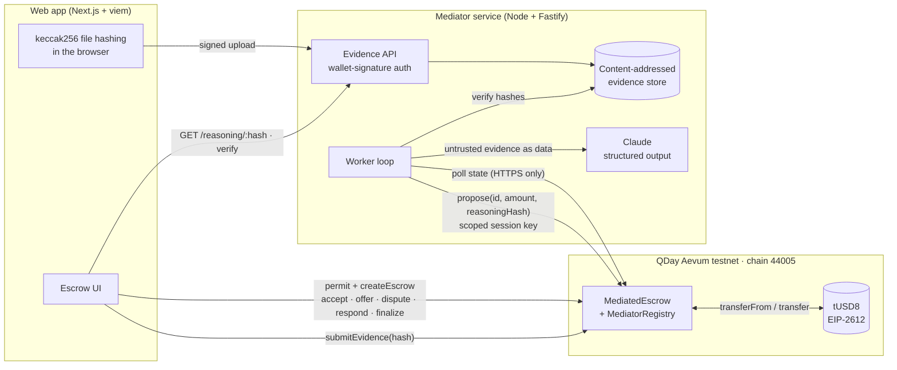
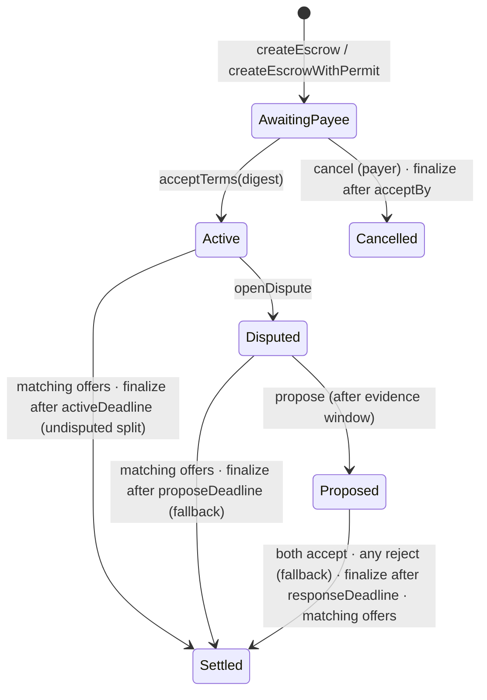
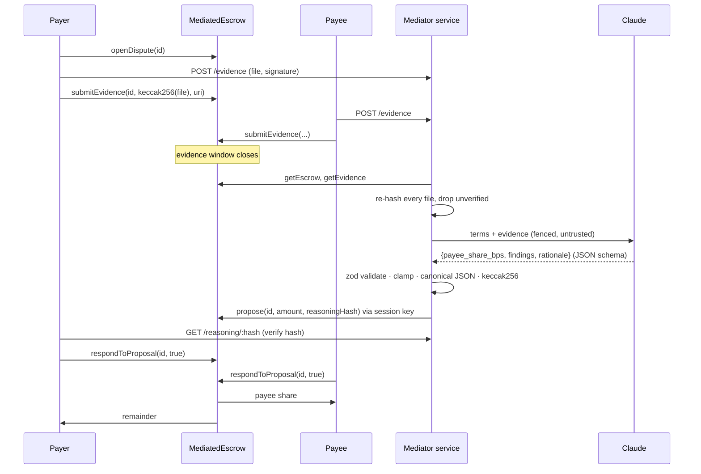

# FairHold

**Stablecoin escrow with an AI mediator that can't touch your money.**

FairHold locks tUSD8 on the QDay Aevum testnet until a job is done. If the payer and payee disagree, an AI mediator reads the hash-verified evidence and proposes one bounded split. The mediator **never holds funds, cannot settle on its own, and either party can reject it**. Every outcome has a deadline that anyone can trigger, so no server, keeper or AI has to stay online for the money to move.

> Aevum Builder Challenge #1 submission · chain `44005` · token tUSD8 · test tokens only

---

## The problem

Freelancers, small merchants, landlords and, increasingly, autonomous agents all pay strangers in stablecoins. A transfer is final, so the payer carries all the risk when paying up front and the payee carries it when paying on delivery. Existing escrows offer two bad options:

* **Trusted arbitrators**: slow, expensive, and a custodian of the dispute.
* **Code-only escrows**: they can't read a delivery receipt, a chat log or a photo of a damaged wall.

AI can read evidence, but an AI agent with signing power over funds is a new attack surface: prompt injection, key compromise and runaway behaviour.

## The solution: bounded agentic mediation

FairHold separates **judgment** (off-chain AI) from **authority** (on-chain rules).

| Layer | Can | Cannot |
| --- | --- | --- |
| Smart contract | Custody tUSD8, enforce deadlines, execute splits | Be bypassed by any off-chain component |
| Parties | Settle by agreement, dispute, submit evidence, accept or reject a proposal | Bind the other party to terms they never accepted |
| AI mediator (session key) | Submit **one** proposal per dispute, ≤ the escrowed amount, with a hash of its rationale | Withdraw, settle, propose twice, or act after its key expires, runs out of budget or is revoked |
| Anyone | Call `finalize` after a deadline to apply the pre-agreed outcome | Choose the outcome |

### What's new here

1. **Scoped mediator session keys.** A mediator is an on-chain identity whose owner key stays cold. The AI service signs with a session key that is *propose-only*, *expiring* (≤ 30 days), *budgeted* (N proposals), and *instantly revocable*. A leaked key can at most waste its remaining budget on proposals that the parties can reject.
2. **Outcome-based on-chain reputation (ERC-8004 style).** The escrow contract itself counts each mediator's `proposals / accepted / unchallenged / rejected / missed`. No self-reporting: parties choose mediators by their track record.
3. **Committed, verifiable AI reasoning.** Every proposal carries `reasoningHash = keccak256(canonical JSON rationale)`. The UI fetches the rationale and shows ✓ only if it hashes to the on-chain value.
4. **Prompt-injection containment by construction.** Evidence is treated as untrusted data (tag-escaped and fenced). The model output is schema-validated twice and range-checked, and the contract rejects anything above the escrow. Even a fully hijacked model can only produce a proposal that either party can reject into the pre-agreed fallback.
5. **Liveness without trust.** If the mediator is offline, `finalize` applies the dispute fallback after `proposeDeadline`. If nobody disputes, the undisputed split applies. If the payee never accepts, the payer is refunded.

---

## Architecture



### Escrow lifecycle



### Dispute sequence



Full design and invariants: [docs/ARCHITECTURE.md](docs/ARCHITECTURE.md).

---

## Repository layout

| Path | What |
| --- | --- |
| [`contracts/src/MediatedEscrow.sol`](contracts/src/MediatedEscrow.sol) | Escrow state machine, settlement, permissionless finalization |
| [`contracts/src/MediatorRegistry.sol`](contracts/src/MediatorRegistry.sol) | Mediator identity, scoped session keys, outcome-based reputation |
| [`contracts/test/`](contracts/test/) | 61 Foundry tests: unit, boundary, reentrancy and fuzz |
| [`contracts/script/`](contracts/script/) | `Deploy`, `SetupMediator`, `LocalDemo` |
| [`mediator/src/`](mediator/src/) | Worker, decision engines (Claude / rules), evidence API, store |
| [`mediator/test/`](mediator/test/) | Unit tests + an end-to-end test on a real anvil chain |
| [`web/`](web/) | Next.js 16 client: create, accept, offer, dispute, evidence, proposal review, mediator console |
| [`docs/`](docs/) | Architecture and demo script |

---

## Testnet deployment

| Item | Value |
| --- | --- |
| Network | QDay Aevum Testnet, chain id `44005` |
| RPC | `https://rpc-test.qday.info` (HTTPS only) |
| Explorer | `https://explorer-test.qday.info` |
| tUSD8 | [`0x456569838f1d43009A91ebA4263147Afd7233483`](https://explorer-test.qday.info/address/0x456569838f1d43009A91ebA4263147Afd7233483) (6 decimals, EIP-2612) |
| MediatedEscrow | `TBD: fill in after make deploy-aevum` |
| Mediator identity | `TBD` |
| Mediator session key | `TBD` |
| Deployed commit | `TBD` |

Example transactions for judges (fill in from your demo run):

| Step | Tx |
| --- | --- |
| Create & fund (permit) | `TBD` |
| Payee accepts terms | `TBD` |
| Dispute opened | `TBD` |
| Evidence committed | `TBD` |
| AI proposal (session key) | `TBD` |
| Settlement | `TBD` |

> The Aevum explorer verifier is not live yet (per the official starter kit). Source matches the commit above; once the verifier works:
> `forge verify-contract <addr> src/MediatedEscrow.sol:MediatedEscrow --chain-id 44005 --verifier blockscout --verifier-url https://explorer-test.qday.info/api/ --constructor-args $(cast abi-encode "c(address)" 0x456569838f1d43009A91ebA4263147Afd7233483)`

---

## Quick start (local, no testnet funds needed)

Prerequisites: Foundry, Node ≥ 22, a browser wallet.

```bash
make install
```

```bash
make build
```

```bash
make test
```

Run the full stack locally against anvil (Shanghai fork rules, same as Aevum):

```bash
anvil --hardfork shanghai
```

```bash
make local-deploy
```

`LocalDemo` deploys a mock tUSD8 and the escrow, mints tokens to anvil accounts 0 (payer) and 1 (payee), registers account 2 as mediator, and grants account 3 a session key. Then:

```bash
cd mediator && cp .env.example .env
```

Set `RPC_URL=http://127.0.0.1:8545`, `CHAIN_ID=31337`, the printed `ESCROW_ADDRESS`, `MEDIATOR_ADDRESS=0x3C44CdDdB6a900fa2b585dd299e03d12FA4293BC`, and `SESSION_KEY_PRIVATE_KEY` to anvil account 3's well-known dev key. Use `MEDIATOR_MODE=rules` if you have no Anthropic key.

```bash
make mediator
```

```bash
cd web && cp .env.example .env.local && npm run dev
```

In `web/.env.local` set chain `31337`, RPC `http://127.0.0.1:8545`, and the printed token and escrow addresses. Import anvil accounts 0 and 1 into your wallet, open http://localhost:3000, and pick the **Live demo (minutes)** template.

## Deploy to Aevum testnet

1. Get tQDAY + tUSD8: Discord `#verify` → `/faucet <address>`, or https://faucet.qday.info.
2. Import keys into encrypted Foundry keystores (never paste keys into files):

   ```bash
   cast wallet import aevum-deployer --interactive
   ```

   ```bash
   cast wallet import aevum-mediator --interactive
   ```

3. Deploy the escrow (legacy tx type; Aevum has no EIP-1559):

   ```bash
   make deploy-aevum
   ```

4. Create a fresh session key for the AI service and authorize it from the mediator owner:

   ```bash
   cast wallet new
   ```

   ```bash
   make setup-mediator ESCROW_ADDRESS=0x... SESSION_KEY=0x...
   ```

   Send the session key a little tQDAY for gas. It needs no tUSD8.
5. Configure and run the mediator (`mediator/.env`) and the web app (`web/.env.local`), or use Docker:

   ```bash
   cp .env.example .env && cp mediator/.env.example mediator/.env
   ```

   ```bash
   docker compose up --build
   ```

---

## Configuration

### Mediator service (`mediator/.env`)

| Variable | Required | Default | Description |
| --- | --- | --- | --- |
| `RPC_URL` | | `https://rpc-test.qday.info` | Aevum RPC (HTTPS) |
| `CHAIN_ID` | | `44005` | Chain id, bound into every signature message |
| `EXPLORER_URL` | | `https://explorer-test.qday.info` | For log links |
| `ESCROW_ADDRESS` | ✓ | | Deployed `MediatedEscrow` |
| `MEDIATOR_ADDRESS` | ✓ | | Mediator **owner** identity (key stays cold) |
| `SESSION_KEY_PRIVATE_KEY` | ✓ to propose | | Scoped session key. The service refuses to start if it is the owner key |
| `MEDIATOR_MODE` | | `claude` | `claude` (AI) or `rules` (pre-agreed fallback, no LLM) |
| `ANTHROPIC_API_KEY` | for `claude` | | Anthropic API credentials |
| `ANTHROPIC_MODEL` | | `claude-opus-5-5` | Model id |
| `PORT` / `HOST` | | `8787` / `0.0.0.0` | HTTP listener |
| `EVIDENCE_DIR` | | `../evidence-data` | Store root (git-ignored). Data lives in `deployments/<CHAIN_ID>-<escrow address>/`, so a redeployed contract or another chain never inherits old jobs or uploads |
| `POLL_INTERVAL_MS` | | `15000` | Chain polling interval (Aevum has no websockets) |
| `CORS_ORIGINS` | | `http://localhost:3000` | Comma-separated allowed web origins |
| `MAX_EVIDENCE_BYTES` | | `5242880` | Upload limit |
| `MAX_SUBMIT_ATTEMPTS` | | `5` | Retries with exponential backoff before a job is marked failed |

### Web (`web/.env.local`)

| Variable | Description |
| --- | --- |
| `NEXT_PUBLIC_CHAIN_ID` | `44005` |
| `NEXT_PUBLIC_RPC_URL` | `https://rpc-test.qday.info` |
| `NEXT_PUBLIC_EXPLORER_URL` | `https://explorer-test.qday.info` |
| `NEXT_PUBLIC_TOKEN_ADDRESS` | tUSD8 address |
| `NEXT_PUBLIC_ESCROW_ADDRESS` | Deployed escrow |
| `NEXT_PUBLIC_DEPLOY_BLOCK` | Deployment block; bounds the chunked event scan |
| `NEXT_PUBLIC_MEDIATOR_URL` | Mediator service base URL |
| `NEXT_PUBLIC_DEFAULT_MEDIATOR` | Pre-selected mediator identity |

---

## Smart contract API

```solidity
// Payer
createEscrow(Terms terms) returns (uint256 id)                      // after approve
createEscrowWithPermit(Terms terms, uint256 deadline, uint8 v, bytes32 r, bytes32 s)  // one tx
cancel(uint256 id)                                                   // before payee accepts

// Payee
acceptTerms(uint256 id, bytes32 expectedDigest)                      // digest = termsDigest(id)

// Either party
offerSettlement(uint256 id, uint128 payeeAmount)                     // settles when offers match
withdrawOffer(uint256 id)
openDispute(uint256 id)
submitEvidence(uint256 id, bytes32 contentHash, string uri)
respondToProposal(uint256 id, bool accept)

// Mediator owner or its session key
propose(uint256 id, uint128 payeeAmount, bytes32 reasoningHash)

// Mediator owner
registerMediator(string uri) · updateMediator(bool active, string uri)
setSessionKey(address key, uint64 expiry, uint32 budget) · revokeSessionKey()

// Anyone
finalize(uint256 id)                                                 // after the relevant deadline
previewFinalize(uint256 id) view returns (bool ready, Resolution, uint128 payeeAmount)
getEscrow · getEvidence · escrowsOf · termsDigest · getMediator · canPropose
```

`Terms = (payee, mediator, amount, acceptBy, activeDuration, evidenceWindow, proposeWindow, responseWindow, undisputedPayeeBps, disputeFallbackPayeeBps, termsHash)`

Examples with `cast` (legacy transactions):

```bash
cast call $ESCROW "getEscrow(uint256)" 1 --rpc-url https://rpc-test.qday.info
```

```bash
cast send $ESCROW "finalize(uint256)" 1 --legacy --account aevum-deployer --rpc-url https://rpc-test.qday.info
```

## Mediator HTTP API

| Method | Path | Auth | Purpose |
| --- | --- | --- | --- |
| `GET` | `/health` | none | Chain, session key authorization, budget, reputation, worker state |
| `GET` | `/jobs` | none | Per-escrow job state (no evidence, no keys) |
| `POST` | `/evidence` | payer/payee signature | Upload evidence or the agreement text |
| `POST` | `/evidence/:hash/read` | payer/payee signature, ≤ 1 h grant, in the JSON body `{escrowId, expires, signature}` | Download evidence (re-verified). Grants never travel in URLs, and request logs record method, path and id only |
| `GET` | `/reasoning/:hash` | none | Mediator rationale; `keccak256(body) == on-chain reasoningHash` |

Upload signature (EIP-191 `personal_sign`; ERC-1271 smart accounts are verified too):

```text
FairHold evidence upload
kind: evidence
chain: 44005
escrow: 0x<escrow lowercase>
id: 7
hash: 0x<keccak256 of file bytes>
```

```bash
curl -X POST $MEDIATOR/evidence -H 'content-type: application/json' -d '{
  "escrowId": "7", "kind": "evidence", "name": "delivery.txt", "mimeType": "text/plain",
  "contentBase64": "RGVsaXZlcmVkIGNvbmNlcHRzIEEgYW5kIEI=", "signature": "0x..." }'
# → 201 {"contentHash":"0x…","uri":"fairhold://evidence/0x…","size":27}
```

```bash
curl -s $MEDIATOR/reasoning/0x6ea7… | cast keccak
# equals getEscrow(id).reasoningHash
```

---

## Safety, trust and controls

| Risk | Control |
| --- | --- |
| Compromised mediator key | The session key is propose-only, expiring, budgeted and revocable. The owner key stays cold. The proposal is bounded by the escrow, and parties can reject it into the fallback. |
| Prompt injection in evidence | Evidence is fenced and tag-escaped, the system prompt marks it as untrusted, and the model flags `suspicious_instructions_detected`. The output is schema-validated twice and range-clamped, then contract-bounded. |
| Runaway agent | One proposal per dispute (state machine), a per-key budget, and a pause switch that blocks all proposals. |
| Mediator offline | `finalize` applies the dispute fallback after `proposeDeadline`. |
| Party disappears | Undisputed and fallback deadlines settle without them. |
| Terms bait-and-switch | The payee signs `termsDigest`, which covers every term and is bound to chain, contract and id. |
| Evidence tampering | On-chain hashes. The store re-hashes on every read, and the UI re-hashes on download. Unverified items are shown to the AI as "missing". |
| Evidence privacy | Raw files never go on-chain. Reads need a fresh party signature (≤ 1 h) and grants are kept in memory only. |
| Malicious evidence files | The browser opens only images, PDFs and text (shown as plain text) after re-checking the hash; HTML, SVG and other active content is downloaded, never rendered in the app's origin. |
| Expired or revoked session key | Disputes wait in a `blocked` state and resume as soon as the key is renewed within the proposal window; otherwise the contract fallback applies. |
| Unconfirmed creation tx | The UI keeps the hash and blocks another creation until the transaction is confirmed or known to have reverted, so funds are never locked twice. |
| Stale offers | Offers reset on every state transition. |
| Reentrancy / transfer failure | Checks-effects-interactions plus `nonReentrant`. A failed transfer reverts the whole settlement. |
| Fee-on-transfer tokens | Rejected by a balance-delta check at funding. |

**Auditability:** every action emits an event. The UI's audit trail links each step to the explorer, and the mediator's reasoning is hash-committed on-chain.

---

## Testing

```bash
cd contracts && forge test
```

61 tests cover creation, permit, invalid terms, acceptance boundaries, digest binding, cancel/expiry, matching and mismatched offers, stale offer reset, evidence windows, per-party and total caps, proposal timing, bounds and authorization, session expiry, budget, revocation and pausing, accept/reject/timeout, mediator timeout, terminal-state lockout, reentrancy, and fuzzing of bps splits, proposal conservation and deadline arithmetic.

```bash
cd mediator && npm test
```

The unit tests cover canonical hashing, bps math, schema rejection, injection fencing, store tamper detection, job persistence, auth messages and config errors. The **end-to-end test** deploys the real contracts on anvil, uploads signed evidence through the HTTP API, rejects a stranger and a fake terms file, advances time, runs the worker, asserts the session key proposed, checks the rationale hash, confirms idempotence and that both accepts move funds.

## Known constraints

* The Aevum explorer verifier isn't live yet, so source is linked by commit.
* Aevum RPC limits `eth_getLogs` to 1,000 blocks, so the UI scans history in bounded chunks. Live state is always read from contract views.
* The evidence store is a single mediator-operated service. The contract stores the commitment, but availability of the files depends on the operator (roadmap: IPFS/Arweave with encryption).
* The mediator rationale is public by design (both parties must be able to verify it). The model is instructed not to repeat personal data.
* There is no protocol or mediator fee yet; see the roadmap.
* An AI recommendation is not legal arbitration. The pre-agreed fallback is the real backstop.

## Roadmap and business model

* **Mediator fees:** an opt-in `feeBps` paid only when a proposal is accepted or unchallenged, so mediators earn only when parties agree they were fair.
* **Protocol fee:** 0.25–0.5% on settled volume, charged to the payer at creation and shown in the review step.
* **Mediator marketplace:** multiple competing AI and human mediators ranked by the on-chain outcome stats; staking with slashing for missed disputes.
* **Agent-to-agent commerce:** an SDK so autonomous agents escrow payments to other agents for tasks, using the same session-key pattern on the payer side (spend caps per counterparty).
* **Encrypted evidence on IPFS** with per-party key wrapping. Multi-milestone escrows. ERC-4337 smart accounts with gas sponsorship once Aevum ships bundler/paymaster support.
* **Distribution:** freelance marketplaces and rental platforms embed a "Pay with FairHold" checkout. Mainnet launch on QDay with tUSD8/USDT.

## Technologies

Solidity 0.8.31 (Shanghai EVM) · Foundry · OpenZeppelin Contracts 5.7 · EIP-2612 permit · ERC-1271 signature verification · ERC-8004-style agent identity and reputation · TypeScript · viem · Fastify · zod · Anthropic Claude (structured outputs, server-side refusal fallback) · Next.js 16 · React 19 · Tailwind CSS 4 · Docker.

## License

MIT. See [LICENSE](LICENSE).
